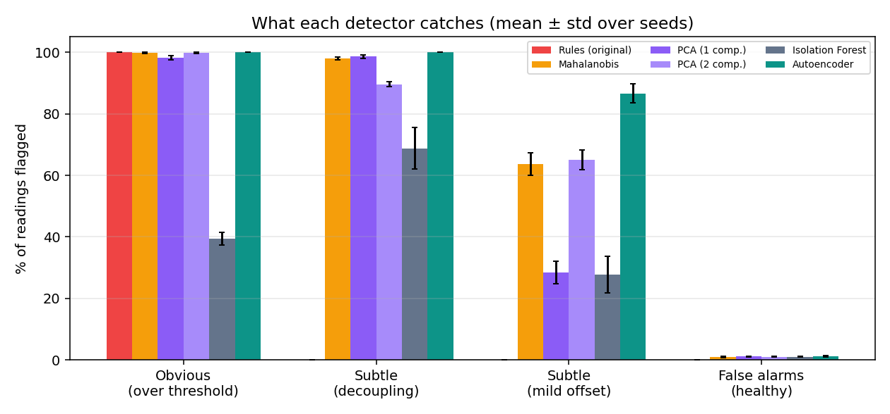

# Real-time Anomaly Detection for Industrial IoT Sensors with an Autoencoder

**Machine Learning Part II & Artificial Neural Networks** · Ndagijimana Pierre (0120000396) · Università degli Studi di Napoli Parthenope

An unsupervised **autoencoder neural network** learns what *normal* machine behaviour looks like from four sensor signals
(temperature, vibration, sound, power consumption). At inference time a high **reconstruction error** flags a reading as
anomalous. The system scores a live sensor stream in real time, raises de-duplicated alerts and shows everything on a dashboard.

Built from two earlier projects (`Machine_learning_two` and `FinalProject-of-Iot2`): see [docs/PROJECT_COMPARISON.md](docs/PROJECT_COMPARISON.md).



## 1. Main result

Trained on **healthy readings only**; tested on faults it never saw during training. Mean ± std over 3 seeds,
same 1 % false-alarm budget for every learned detector (full protocol and more figures: [docs/RESULTS.md](docs/RESULTS.md)).

| Detector | ROC-AUC | Avg. precision | Precision | Recall | F1 | False-alarm rate |
|---|---|---|---|---|---|---|
| Rules (original) | 0.699 ± 0.006 | 0.559 ± 0.009 | 1.000 ± 0.000 | 0.398 ± 0.011 | 0.569 ± 0.012 | 0.0 ± 0.0 % |
| Mahalanobis | 0.988 ± 0.002 | 0.972 ± 0.002 | 0.947 ± 0.009 | 0.917 ± 0.007 | 0.932 ± 0.003 | 0.9 ± 0.1 % |
| PCA (1 comp.) | 0.975 ± 0.001 | 0.941 ± 0.002 | 0.934 ± 0.010 | 0.842 ± 0.005 | 0.886 ± 0.002 | 1.1 ± 0.2 % |
| PCA (2 comp.) | 0.980 ± 0.004 | 0.957 ± 0.005 | 0.940 ± 0.007 | 0.887 ± 0.007 | 0.913 ± 0.001 | 1.0 ± 0.1 % |
| Isolation Forest | 0.958 ± 0.003 | 0.831 ± 0.012 | 0.895 ± 0.008 | 0.488 ± 0.044 | 0.631 ± 0.038 | 1.0 ± 0.1 % |
| **Autoencoder** | 0.996 ± 0.001 | 0.991 ± 0.001 | 0.941 ± 0.014 | 0.973 ± 0.006 | 0.957 ± 0.004 | 1.1 ± 0.3 % |

| Detector | Obvious: over threshold | Subtle: decoupling | Subtle: mild offset | False alarms on healthy |
|---|---|---|---|---|
| Rules (original) | 100.0 ± 0.0 % | 0.0 ± 0.0 % | 0.0 ± 0.0 % | 0.0 ± 0.0 % |
| Mahalanobis | 99.8 ± 0.3 % | 98.0 ± 0.4 % | 63.6 ± 3.7 % | 0.9 ± 0.1 % |
| PCA (1 comp.) | 98.3 ± 0.7 % | 98.6 ± 0.6 % | 28.5 ± 3.6 % | 1.1 ± 0.2 % |
| PCA (2 comp.) | 99.8 ± 0.3 % | 89.7 ± 0.7 % | 65.1 ± 3.2 % | 1.0 ± 0.1 % |
| Isolation Forest | 39.5 ± 2.0 % | 68.8 ± 6.8 % | 27.8 ± 5.9 % | 1.0 ± 0.1 % |
| **Autoencoder** | 100.0 ± 0.0 % | 100.0 ± 0.0 % | 86.7 ± 3.1 % | 1.1 ± 0.3 % |

**What this shows**
* The original threshold rules are perfect on *obvious* faults and blind to every *subtle* one: they can only see a sensor crossing its limit.
* Faults that keep each sensor inside its normal range but break the **relationships** between sensors are found by models that learned normal behaviour.
* The autoencoder has the best F1 and the best detection of the hardest type (mild offsets). On ROC-AUC the strongest linear baseline
  (Mahalanobis, 0.988) is close to the autoencoder (0.996): the neural network's advantage is real but modest, and largest on the subtle cases.
* Ablations (docs/RESULTS.md §4): a **narrow bottleneck matters** (width 1: F1 0.957, width 4: 0.932); a deeper network or input noise (denoising) change nothing.

## 2. System

```
 ┌───────────────┐  TCP :9999  ┌────────────────────────────┐   batches    ┌─────────────────────┐
 │ simulator     │ ──────────▶ │ stream_processor.py        │ ───────────▶ │ storage             │
 │ 15 machines   │ CSV lines   │ 1 parse                    │              │  local folder / HDFS│
 │ 3 fault types │             │ 2 rule check (original)    │              │  all, alerts,       │
 └───────────────┘             │ 3 autoencoder + sensor hint│              │  ae_anomalies,      │
        │ batch CSV            │ 4 alert engine ──▶ webhook │              │  metrics.json       │
        ▼                      │ 5 live metrics             │              └──────────┬──────────┘
 ┌───────────────┐  model.npz  └─────────────▲──────────────┘                         │ read
 │ train.py      │ ────────────────────────┘                                          ▼
 │ healthy only  │            benchmark.py (offline evaluation)           dashboard.py :5000
 └───────────────┘
```

**The model** ([anomaly/model.py](anomaly/model.py)): NumPy only (no TensorFlow/PyTorch). Layers 4 → 32 → *b* → 32 → 4,
ReLU, linear output, He initialisation, Adam, mini-batches. Early stopping on the reconstruction loss of *healthy* validation
data. The bottleneck width *b* (1-4) is chosen on validation ROC-AUC. Inputs are z-scored **per machine type**, fitted on healthy training rows.
**The alert threshold** is the 99th percentile of healthy validation error (a ~1 % false-alarm budget); the trade-off is in docs/RESULTS.md §5.
**The sensor hint** says which sensor deviates most from its reconstruction, scaled by its healthy residual spread and counting only upward deviations.

**The data** ([anomaly/simulator.py](anomaly/simulator.py)): one hidden machine load drives temperature, vibration, sound and power through curved
responses. Fault types: `threshold` (a sensor beyond its safe limit), `decoupling` (all sensors inside their ranges but inconsistent, e.g. hot motor with
low power draw), `mild_offset` (one or two sensors shifted by 20-35 % of their range, kept in range). Labels are emitted for evaluation only.

**Alerts** ([anomaly/alerting.py](anomaly/alerting.py)): one alert per machine per cooldown window, level WARNING or CRITICAL, a likely-cause hint, and an
optional webhook (`ALERT_WEBHOOK=https://...`). On a live run about 600 flagged readings became about 30 alerts.

## 3. Run it

**Laptop (about 1 minute, Python 3.9+, no other software):**
```bash
pip install -r requirements.txt
python run_demo.py                          # trains, streams, scores, opens http://localhost:5000
python -m unittest discover -s tests        # 20 tests
pip install -r requirements-dev.txt && python benchmark.py   # regenerates docs/RESULTS.md and figures (about 3 min)
```
**Docker:** `docker compose up --build`, then open http://localhost:5000. *(Compose file validated, not run.)*
**Hadoop / Google Cloud VM (from the IoT project):** `PUBLIC_IP=<ip> bash scripts/start_cluster.sh` stores the model and all results in HDFS. *(Tested against a mock `hdfs` command, not a real cluster.)*
**Flink + PostgreSQL (from the ML project):** see [flink/README.md](flink/README.md). *(Untested.)*

## 4. Limitations - read before presenting

* **The data is simulated.** Fault types, their share and the sensor relationships are my modelling assumptions. Results on real machines are unknown.
  The simulator is designed so that subtle faults are invisible to threshold rules; how well each model detects them is measured, not assumed.
* **The sensor relationships are generated by one hidden load,** so a bottleneck of width 1 is the right answer by construction (the benchmark rediscovers it).
  Real machines have more degrees of freedom.
* **Simulator history:** an earlier version mislabelled some mild-offset faults (the shift was clipped away, leaving a healthy reading). Found by inspecting the
  error histogram and fixed; all reported numbers are from the corrected simulator, and every detector benefited.
* **Faults are independent per reading.** No temporal behaviour (gradual drift, sequences) is modelled; a recurrent or windowed model is future work.
* **The "likely cause" hint is a hint,** not a diagnosis. It never blamed the untouched power sensor on obvious faults, but with several sensors off at once it cannot say which is the root cause.
* **Alert severity** (CRITICAL if error is at least 3x the threshold or the rules agree) is a heuristic.
* **Not tested here:** Docker run, Flink, PostgreSQL, real HDFS. Everything else was run, including the live stream and the dashboard.

## 5. Repository

| Path | Purpose |
|---|---|
| `anomaly/simulator.py`, `simulate_factory_data.py` | sensor simulator, fault types, TCP stream, CSV (same CLI as the original) |
| `anomaly/model.py` | autoencoder, early stopping, scorer, sensor hint |
| `anomaly/baselines.py`, `anomaly/evaluation.py` | rules, Mahalanobis, PCA, Isolation Forest; split, metrics, model selection |
| `train.py`, `benchmark.py` | training; multi-seed comparison, ablations, figures |
| `stream_processor.py`, `anomaly/alerting.py`, `dashboard.py` | real-time scoring, alerts, live dashboard |
| `anomaly/storage.py` | one interface for a local folder or HDFS |
| `Dockerfile`, `docker-compose.yml`, `scripts/` | Docker and Hadoop-VM start-up |
| `tests/`, `.github/workflows/` | 20 unit tests, CI |
| `docs/` | RESULTS.md + figures, PROJECT_COMPARISON.md |

*Based on [MbarekTech/Flink-sensor-processing](https://github.com/MbarekTech/Flink-sensor-processing) (MIT) through the earlier `Machine_learning_two` project.*
