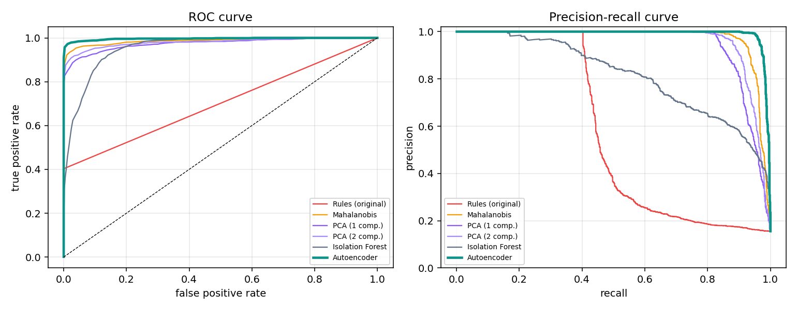
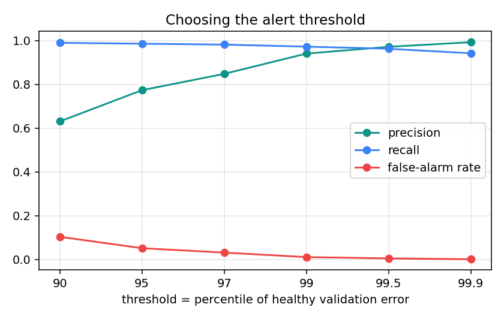
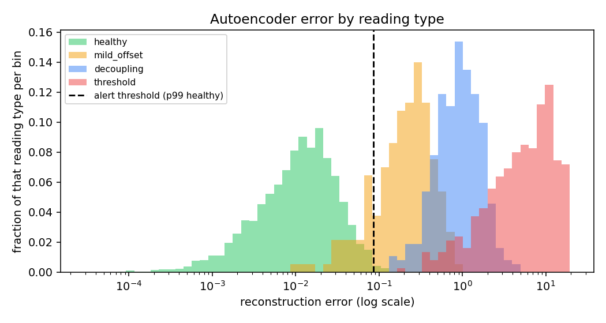
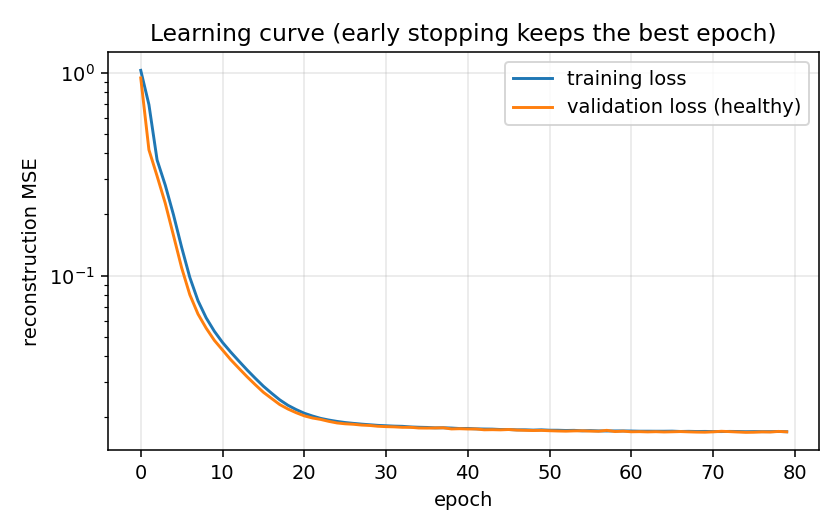
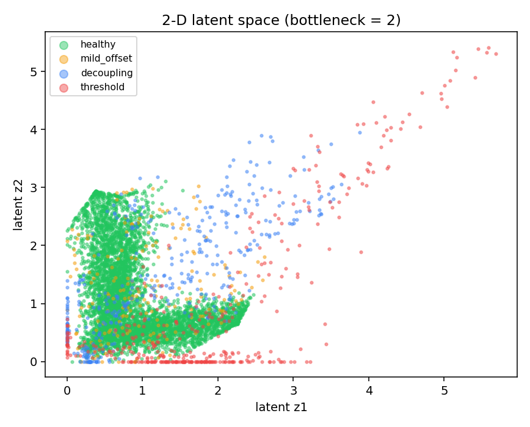

# Results

Simulated data (40,000 readings per seed, 15 % faults: 40 % obvious, 40 % decoupling, 20 % mild offset),
**3 independent seeds**, mean ± standard deviation. Test split only (the last 15 % in time).
Learned models are fitted on healthy readings only. Alert threshold = 99th percentile of healthy validation error
for every learned detector, i.e. the same ~1 % false-alarm budget. The autoencoder's bottleneck width chosen per seed: [1, 1, 1].

## 1. Overall detection quality

| Detector | ROC-AUC | Avg. precision | Precision | Recall | F1 | False-alarm rate |
|---|---|---|---|---|---|---|
| Rules (original) | 0.699 ± 0.006 | 0.559 ± 0.009 | 1.000 ± 0.000 | 0.398 ± 0.011 | 0.569 ± 0.012 | 0.0 ± 0.0 % |
| Mahalanobis | 0.988 ± 0.002 | 0.972 ± 0.002 | 0.947 ± 0.009 | 0.917 ± 0.007 | 0.932 ± 0.003 | 0.9 ± 0.1 % |
| PCA (1 comp.) | 0.975 ± 0.001 | 0.941 ± 0.002 | 0.934 ± 0.010 | 0.842 ± 0.005 | 0.886 ± 0.002 | 1.1 ± 0.2 % |
| PCA (2 comp.) | 0.980 ± 0.004 | 0.957 ± 0.005 | 0.940 ± 0.007 | 0.887 ± 0.007 | 0.913 ± 0.001 | 1.0 ± 0.1 % |
| Isolation Forest | 0.958 ± 0.003 | 0.831 ± 0.012 | 0.895 ± 0.008 | 0.488 ± 0.044 | 0.631 ± 0.038 | 1.0 ± 0.1 % |
| **Autoencoder** | 0.996 ± 0.001 | 0.991 ± 0.001 | 0.941 ± 0.014 | 0.973 ± 0.006 | 0.957 ± 0.004 | 1.1 ± 0.3 % |

## 2. What each detector catches, by fault type

| Detector | Obvious: over threshold | Subtle: decoupling | Subtle: mild offset | False alarms on healthy |
|---|---|---|---|---|
| Rules (original) | 100.0 ± 0.0 % | 0.0 ± 0.0 % | 0.0 ± 0.0 % | 0.0 ± 0.0 % |
| Mahalanobis | 99.8 ± 0.3 % | 98.0 ± 0.4 % | 63.6 ± 3.7 % | 0.9 ± 0.1 % |
| PCA (1 comp.) | 98.3 ± 0.7 % | 98.6 ± 0.6 % | 28.5 ± 3.6 % | 1.1 ± 0.2 % |
| PCA (2 comp.) | 99.8 ± 0.3 % | 89.7 ± 0.7 % | 65.1 ± 3.2 % | 1.0 ± 0.1 % |
| Isolation Forest | 39.5 ± 2.0 % | 68.8 ± 6.8 % | 27.8 ± 5.9 % | 1.0 ± 0.1 % |
| **Autoencoder** | 100.0 ± 0.0 % | 100.0 ± 0.0 % | 86.7 ± 3.1 % | 1.1 ± 0.3 % |

## 3. Curves

## 4. Autoencoder ablations (same protocol)

| Variant | ROC-AUC | F1 | Detects mild offset | Detects decoupling |
|---|---|---|---|---|
| bottleneck 1 | 0.996 ± 0.001 | 0.957 ± 0.004 | 86.7 ± 3.1 % | 100.0 ± 0.0 % |
| bottleneck 2 | 0.987 ± 0.002 | 0.947 ± 0.008 | 77.5 ± 3.5 % | 100.0 ± 0.0 % |
| bottleneck 3 | 0.980 ± 0.009 | 0.934 ± 0.017 | 69.9 ± 7.7 % | 98.5 ± 1.3 % |
| bottleneck 4 | 0.980 ± 0.003 | 0.932 ± 0.008 | 68.1 ± 6.4 % | 98.9 ± 0.8 % |
| 2 hidden layers | 0.997 ± 0.001 | 0.956 ± 0.003 | 87.0 ± 3.0 % | 99.9 ± 0.1 % |
| denoising (noise 0.1) | 0.996 ± 0.001 | 0.957 ± 0.004 | 86.9 ± 2.8 % | 99.9 ± 0.1 % |

## 5. Choosing the alert threshold (autoencoder)

| Threshold percentile | Precision | Recall | False-alarm rate |
|---|---|---|---|
| 90 | 63.1 ± 1.6 % | 99.1 ± 0.3 % | 10.4 ± 0.5 % |
| 95 | 77.4 ± 1.3 % | 98.6 ± 0.3 % | 5.2 ± 0.3 % |
| 97 | 84.9 ± 0.7 % | 98.2 ± 0.2 % | 3.1 ± 0.2 % |
| 99 | 94.1 ± 1.4 % | 97.3 ± 0.6 % | 1.1 ± 0.3 % |
| 99.5 | 97.2 ± 0.6 % | 96.3 ± 0.5 % | 0.5 ± 0.1 % |
| 99.9 | 99.3 ± 0.2 % | 94.3 ± 0.4 % | 0.1 ± 0.0 % |

## 6. What the network learned

